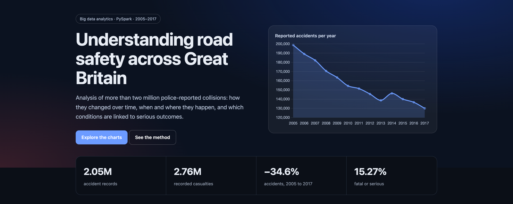
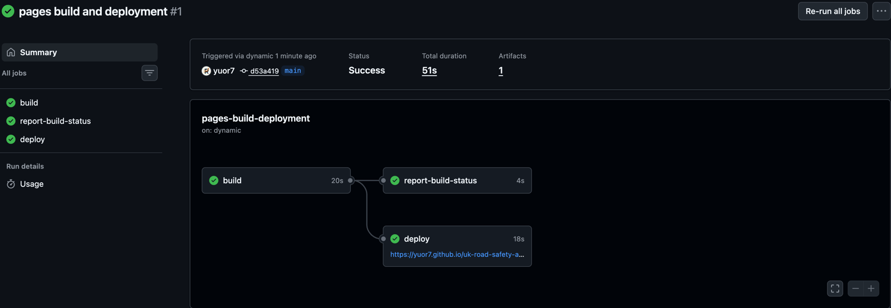

# UK Road Safety Analytics

Big-data analysis of 2M+ police-reported UK road collisions (2005–2017) using PySpark, with a static website that presents the results.

**Live site: [yuor7.github.io/uk-road-safety-analytics](https://yuor7.github.io/uk-road-safety-analytics/)**

[](https://yuor7.github.io/uk-road-safety-analytics/)
[](https://yuor7.github.io/uk-road-safety-analytics/)

[](https://yuor7.github.io/uk-road-safety-analytics/)

## What's inside

| Path | Description |
|---|---|
| `UK_Road_Safety_Big_Data_Analytics.ipynb` | Full analysis: data validation, cleaning, EDA, statistical tests, baseline severity model |
| `docs/index.html` | Self-contained project website (charts embedded, no build step) |
| `assets/` | Screenshots used in this README |

## Highlights

- 2.05M accident records, 2.76M casualties, 2.18M vehicle involvements
- Accidents fell 34.6% from 2005 to 2017
- Peak at 17:00, Fridays and November; 15.27% of accidents are Fatal or Serious
- Weather and road surface associations with severity are significant but weak (Cramér's V ≈ 0.01–0.02)
- Baseline logistic regression: ROC-AUC 0.623, weighted F1 0.646

## Run the notebook

```bash
pip install pyspark pandas matplotlib plotly folium scipy scikit-learn jupyter
jupyter notebook UK_Road_Safety_Big_Data_Analytics.ipynb
```

Download the CSVs from the Kaggle dataset below and update the file paths in the first cells.

## Deployment

The website is served by GitHub Pages from the `/docs` folder on the `main` branch. Every push to `main` triggers an automatic build and deploy.



## Data sources

- [Kaggle: UK Road Safety accidents and vehicles](https://www.kaggle.com/datasets/tsiaras/uk-road-safety-accidents-and-vehicles)
- [DfT road safety open data](https://www.gov.uk/government/statistical-data-sets/road-safety-open-data)

## Limitations

Counts are not exposure-adjusted risk rates, results show association not causation, and the model is an academic baseline.
